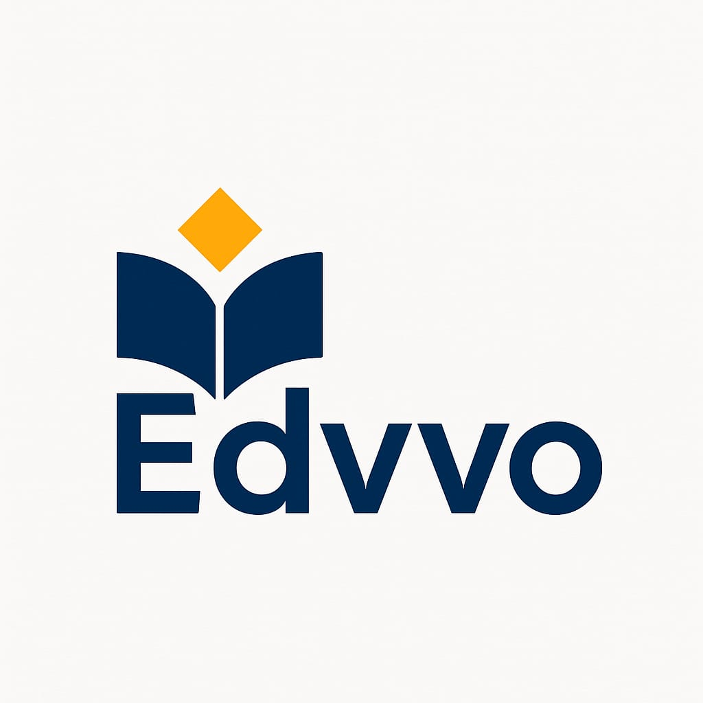

<div align="center">
  
  <h1 style="font-size:2.5rem; margin-bottom:0;">Edvvo Platform</h1>
  <p style="font-size:1.2rem; margin-top:0; color:#555;"><b>Your Gateway to Modern Educational Resources</b></p>
</div>

<p align="center">
  
  
  
  
  
  
</p>

---

## About

**Edvvo** is a comprehensive educational platform designed for Pakistani students (classes 9–12 and beyond). It provides free access to textbooks, notes, scholarly research, academic field guides, entry test preparation, and productivity tools — all in one responsive, modern web application.

---

## Features

### Educational Content
| Feature | Description |
|---------|-------------|
| **Books** | Downloadable textbooks for classes 9, 10, 11, and 12 organized by board |
| **Notes** | Study notes with categorized resources across all major subjects |
| **Scholarly Vault** | Access to research papers and academic publications |
| **Board Selector** | Browse content by education board (Federal, Punjab, Sindh, KPK, Balochistan, AJK) |
| **Academic Explorer** | Interactive tool to discover academic disciplines and career paths |
| **Entry Test Prep** | Practice materials for MDCAT, ECAT, NTS, and other entry tests |
| **MindSprint** | Quick quiz/review tool integrated into the explore experience |

### Academic Fields (11 Disciplines)
Detailed guide pages for each field including overview, universities, career paths, and resources:
- Islamic Studies
- Engineering & Applied Science
- Computer Science & IT
- Business & Finance
- Natural & Biological Sciences
- Health & Para-Medical Sciences
- Social Sciences & Humanities
- Architecture & Design
- Law
- Education
- Agriculture & Veterinary Sciences

### Academic Programs
- Engineering Programs (sub-disciplines and specializations)
- Applied Science Programs

### Productivity & Workspace
| Feature | Description |
|---------|-------------|
| **Focus Timer** | Pomodoro-style timer to boost study sessions |
| **Roadmaps** | Visual learning roadmaps for various career paths |
| **Solutions** | Problem solutions and detailed explanations |
| **Study Plans** | Structured study plan generator |

### UI/UX
- **Dark/Light Theme** toggle with system preference detection
- **Global Search** across all books, notes, and resources
- **Responsive Design** — optimized for mobile, tablet, and desktop
- **Notification System** with detail pages for updates and announcements

---

## Tech Stack

| Technology | Purpose |
|-----------|---------|
| **React 18** | UI framework with hooks and functional components |
| **TypeScript** | Type safety across the entire codebase |
| **Vite 5** | Fast build tool with HMR and path alias (`@/` → `src/`) |
| **Tailwind CSS 3** | Utility-first styling with custom theme and animations |
| **React Router 6** | Client-side routing with centralized route definitions |
| **Radix UI** | Accessible primitives (NavigationMenu, Slot) |
| **Lucide React** | Consistent icon library throughout the UI |
| **Swiper** | Touch-friendly carousels and sliders |
| **clsx + tailwind-merge** | Conditional class name utility (`cn()` helper) |
| **Vitest** | Unit testing with React Testing Library |

---

## Getting Started

### Prerequisites

- [Node.js](https://nodejs.org/) v16 or higher
- npm (comes with Node.js)

### Installation

```bash
git clone https://github.com/Zeeshan-py/Edvvo.git
cd Edvvo
npm install
```

### Development

```bash
npm run dev
```

Opens at [http://localhost:5173/](http://localhost:5173/) with hot module replacement.

### Production Build

```bash
npm run build
```

Outputs optimized static files to `dist/`.

### Testing

```bash
npm test              # Run tests
npm run test:ui       # Run tests with UI
npm run test:coverage # Run tests with coverage report
```

---

## Project Structure

```
src/
├── components/
│   └── ui/                         # Shared UI components
│       ├── book-card.tsx           #   Book display card
│       ├── button.tsx              #   Reusable button (CVA variants)
│       ├── card.tsx                #   Card container components
│       ├── input.tsx               #   Form input component
│       ├── navigation-menu.tsx     #   Main navigation (Radix-based)
│       └── theme-toggle.tsx        #   Dark/light mode switcher
│
├── pages/
│   ├── Home/
│   │   ├── LandingPage.tsx         # Main landing page
│   │   ├── NotificationDetailPage.tsx
│   │   └── sections/
│   │       ├── HeroSection/        #   Hero banner with search
│   │       ├── FeaturedBooksSection/#   Recently added books carousel
│   │       ├── ExploreByCategorySection/
│   │       ├── SearchSection/      #   Global search with filters
│   │       ├── FooterSection/      #   Site-wide footer
│   │       └── NotificationPage.tsx
│   │
│   ├── Explore/
│   │   ├── ExplorePage.tsx         # Main explore hub
│   │   ├── BoardPage.tsx           # Board-specific content browser
│   │   ├── EntertainmentPage.tsx   # Educational entertainment
│   │   ├── EntryTestPage.tsx       # Entry test preparation
│   │   ├── ScholarlyVault.tsx      # Research papers & publications
│   │   ├── AcademicExplorer.tsx    # Interactive discipline explorer
│   │   ├── ResultPage.tsx          # Search/filter results
│   │   ├── MindSprint.tsx          # Quick quiz component
│   │   ├── books/                  # Class 9–12 textbooks
│   │   ├── notes/                  # Class 9–12 study notes
│   │   ├── fields/                 # 11 academic discipline pages
│   │   └── programs/               # Degree program pages
│   │
│   ├── Workspace/
│   │   ├── RoadmapsPage.tsx        # Learning roadmaps
│   │   ├── FocusTimerPage.tsx      # Pomodoro focus timer
│   │   ├── SolutionsPage.tsx       # Solutions listing
│   │   ├── SolutionDetailPage.tsx  # Individual solution view
│   │   └── StudyPlanPage.tsx       # Study plan generator
│   │
│   └── About/
│       ├── AboutPage.tsx           # About Edvvo
│       ├── PrivacyPolicyPage.tsx   # Privacy policy
│       └── TermsOfServicePage.tsx  # Terms of service
│
├── router/
│   └── index.tsx                   # Centralized route definitions
│
├── utils/
│   ├── cn.ts                       # className merge utility (clsx + twMerge)
│   ├── globalResources.ts          # Aggregated books/notes for search
│   ├── notificationsData.ts        # Notification content data
│   └── recentlyAddedBooks.ts       # Recently added books data
│
├── styles/
│   └── tailwind.css                # Tailwind directives & custom CSS
│
├── types/
│   └── index.ts                    # Shared interfaces (Book, Resource, Category)
│
├── test/
│   └── setup.ts                    # Vitest test setup
│
└── index.tsx                       # App entry point (React root + Router)
```

---

## Routes

| Path | Page | Description |
|------|------|-------------|
| `/` | LandingPage | Home page with hero, search, featured books |
| `/explore` | ExplorePage | Main content exploration hub |
| `/board/:boardId` | BoardPage | Board-specific books, notes, quiz |
| `/entertainment` | EntertainmentPage | Educational entertainment |
| `/entry-test` | EntryTestPage | Entry test practice materials |
| `/scholarly-vault` | ScholarlyVault | Research papers browser |
| `/academic-explorer` | AcademicExplorer | Interactive field discovery |
| `/result` | ResultPage | Search results |
| `/islamic-studies` | IslamicStudiesPage | Islamic Studies field guide |
| `/engineering-applied-science` | EngineeringAppliedSciencePage | Engineering overview |
| `/engineering-programs` | EngineeringProgramsPage | Engineering sub-disciplines |
| `/applied-science-programs` | AppliedScienceProgramsPage | Applied science degrees |
| `/computer-science` | ComputerSciencePage | CS & IT field guide |
| `/business-finance` | BusinessFinancePage | Business & Finance guide |
| `/natural-biological-sciences` | NaturalBiologicalSciencesPage | Natural Sciences guide |
| `/health-paramedical` | HealthParaMedicalPage | Health Sciences guide |
| `/social-sciences-humanities` | SocialSciencesHumanitiesPage | Social Sciences guide |
| `/architecture-design` | ArchitectureDesignPage | Architecture guide |
| `/law` | LawPage | Law field guide |
| `/education` | EducationPage | Education field guide |
| `/agriculture-vet` | AgricultureVetPage | Agriculture & Vet guide |
| `/roadmaps` | RoadmapsPage | Career learning roadmaps |
| `/focus-timer` | FocusTimerPage | Pomodoro timer |
| `/solutions` | SolutionsPage | Solutions listing |
| `/solutions/:id` | SolutionDetailPage | Solution detail |
| `/study-plan` | StudyPlanPage | Study plan generator |
| `/about` | AboutPage | About Edvvo |
| `/privacy-policy` | PrivacyPolicyPage | Privacy policy |
| `/terms-of-service` | TermsOfServicePage | Terms of service |
| `/notifications/:id` | NotificationDetailPage | Notification detail |

---

## Contributing

1. Fork the repository
2. Create your feature branch (`git checkout -b feature/your-feature`)
3. Commit your changes (`git commit -m 'Add your feature'`)
4. Push to the branch (`git push origin feature/your-feature`)
5. Open a pull request

Please open issues for bugs or feature requests.

---

## License

This project is licensed under the MIT License.

---

## Contact

For questions, feedback, or partnership inquiries, please contact the project maintainer.
